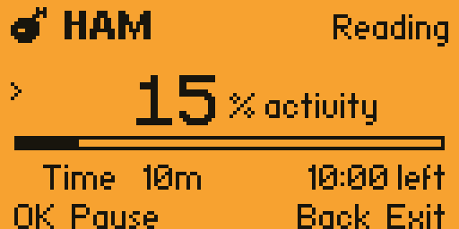

# HAM — Human Activity Mimic

A Flipper Zero USB app that combines fast typing bursts, mouse movements, occasional clicks, and pauses. One activity control adjusts how busy it feels.

Tested on macOS with official Flipper firmware **1.5.1 / API 88.2**. Uses US QWERTY keyboard mapping.



## Install

Copy [ham.fap](releases/ham.fap) to `apps/USB/` on your Flipper's SD card using qFlipper. Open **Apps → USB → HAM**.

The included build requires compatible firmware. For a different SDK/API version, rebuild from source.

## Use

Open a blank text document, focus it, and place the pointer inside the text area. HAM opens paused.

- **Up / Down:** select Activity or Time.
- **Left / Right:** adjust the selected setting.
- **OK:** start or pause; start a new session after completion.
- **Back:** stop and exit.

Time presets are **5m, 10m, 30m, 1h, 2h, and ∞**. Timed sessions show time remaining; infinite sessions count up until you stop them. Paused time does not count. Activity and duration are saved on normal exit. Changing duration during a session applies to its total active time, rather than restarting the clock.

The ham wiggles while running and stays still while paused. At 0% activity, HAM pauses. Higher activity shortens the gaps between episodes; it does not simply speed up every action.

While HAM is open, the Flipper acts as a keyboard and mouse, so its normal USB serial connection disappears. Exit with Back to reconnect to qFlipper.

## Customize

HAM creates two files on its SD card:

- `apps_data/ham/text.txt` — replace the sample sentences with your own ASCII text.
- `apps_data/ham/profile.txt` — edit the settings, then reopen HAM.

```ini
activity=50
radius=600
duration_seconds=600
wpm_min=100
wpm_max=130
click_percent=25
seed=0
```

`radius` limits the estimated movement area in **relative HID counts, not pixels**. Most moves are short; a few are larger. Mac pointer acceleration and manual movement affect actual position. HAM cannot see the screen or guarantee that clicks stay inside a window. Set `click_percent=0` to disable clicks.

`duration_seconds=0` enables infinite mode. The default remains 600 seconds (10 minutes).

Text loops, with line breaks flattened into spaces. `seed=0` chooses fresh randomness. A positive seed makes engine simulations repeatable with the same settings and input timing.

See [behavior details](docs/behavior.md) for episode probabilities and timing.

## Build

Install Python 3 and create an environment from the project root:

```sh
python3 -m venv .venv
.venv/bin/python -m pip install ufbt
cd ham
../.venv/bin/ufbt
```

Output: `ham/dist/ham.fap`. Use a Flipper SDK matching your firmware; [uFBT](https://github.com/flipperdevices/flipperzero-ufbt) downloads the release SDK by default.

Screenshot capture is disabled in normal builds. See [developer preview instructions](docs/development.md) for the build flag and catalog screenshot preparation.

## Test

From the project root, using a C compiler:

```sh
cc -O1 -std=c11 -Wall -Wextra -Werror -fsanitize=undefined \
  tests/engine_test.c ham/engine.c -lm -o /tmp/ham-test
/tmp/ham-test

cc -O2 -Wall -Wextra -Werror -DCHECK_CONTROLLED -I ham \
  tests/mouse_metrics.c ham/engine.c -lm -o /tmp/ham-mouse-test
/tmp/ham-mouse-test
```

The checks cover 800 simulated sessions, input pairing, timing, movement bounds, pause behavior, duration presets, infinite operation, timer wraparound, and movement distribution. They do not validate how human the behavior looks.

## License

[MIT](LICENSE), copyright 2026 lumen-rot.
